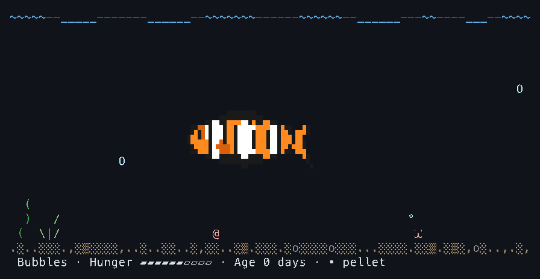
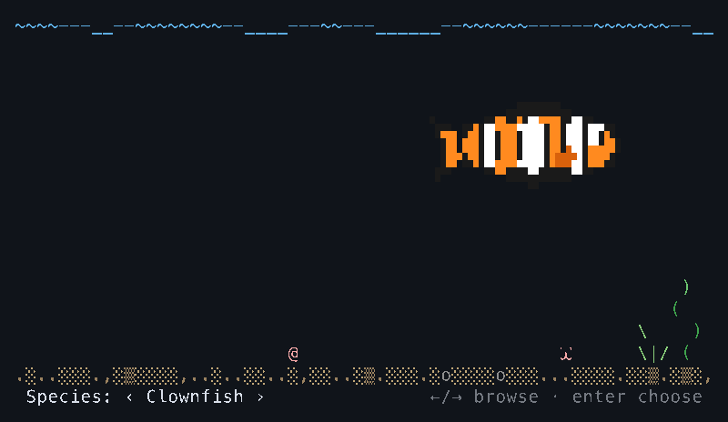
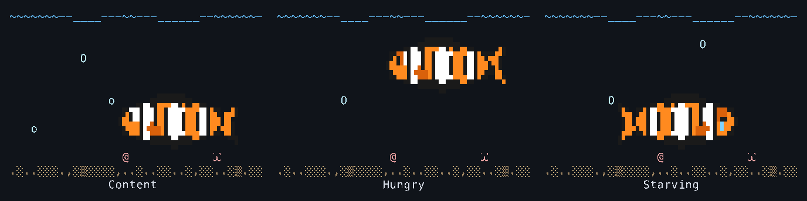
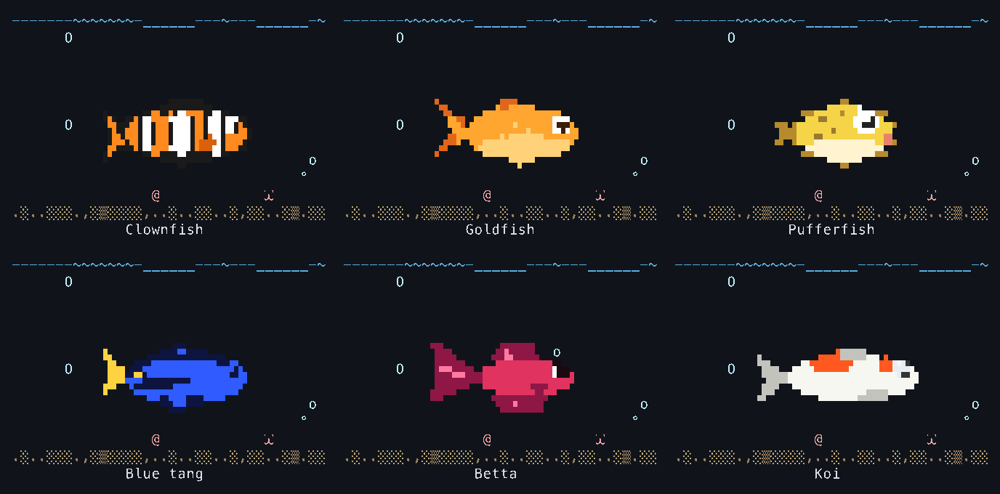

# shellfish

A virtual pet Fish that lives in your terminal. You name it, feed it and keep it company, and it carries on living while the app is closed: it gets hungry in real time, but it never dies.



## Install

**Homebrew** (macOS and Linux):

```sh
brew install kyu-seok/tap/shellfish
```

If Homebrew asks you to trust the tap first, run `brew trust kyu-seok/tap` and install again.

**npm:**

```sh
npm install -g @kyu-seok/shellfish
# or try it without installing:
npx @kyu-seok/shellfish
```

**Go** (1.24 or later):

```sh
go install github.com/Kyu-seok/shellfish@latest
```

Or download a binary for macOS, Linux or Windows from the [Releases page](https://github.com/Kyu-seok/shellfish/releases).

## Play

Run `shellfish`. The first time, pick a Species and give your Fish a name.



| Do this | And |
| --- | --- |
| Click the water | Drop Food where you clicked |
| `f` or space | Drop Food at the top of the Tank |
| `1`, `2`, `3` | Choose the Food: pellet, flake or worm |
| Click the Fish | Pat it: it wiggles and sends up a heart |
| Move the mouse over the Tank | A curious Fish swims over to see |
| `r` | Release the Fish, to start again with a new one |
| `d` | Switch the Fish between Fine and Coarse Detail |
| `q` or Esc | Close the Tank (the Fish carries on living) |

The Fish shows how it feels: Content, Hungry or Starving. A hungry Fish dashes for Food, and a Starving one droops to the bottom of the Tank until it's fed.



There are ten Species to choose from. Here are six:



The Tank needs a window of at least 30×10 and a terminal with 256 colours; with fewer, or with `NO_COLOR` set, the Fish is drawn as a silhouette. In tmux, turn on `set -g mouse on` for the mouse.

The pictures here show the Fish in Fine Detail, drawn in sextant characters. Ghostty, kitty, WezTerm, foot, Alacritty, iTerm2 3.6.7 or later and other recent terminals draw those themselves, so the Tank opens Fine. Elsewhere, such as Terminal.app, older iTerm2, tmux or over ssh, the Fish starts in Coarse Detail, which every font can show. If your font has sextants (Iosevka, Cascadia Code, JuliaMono and others do), press `d` for Fine; your terminal remembers the choice. If the Fish turns to boxes, press `d` again.

`shellfish --version` and `shellfish --help` work any time, even while a Tank is open.

## Where your Fish lives

One Fish is saved per user, in `shellfish/fish.json`, with the Detail you picked in each terminal in `shellfish/detail.json`, under:

- macOS: `~/Library/Application Support`
- Linux: `$XDG_DATA_HOME`, or `~/.local/share`
- Windows: `%LOCALAPPDATA%`

If `$XDG_DATA_HOME` is set, it is used on any system.

Only one Tank can be open at a time.

## License

[MIT](LICENSE)
